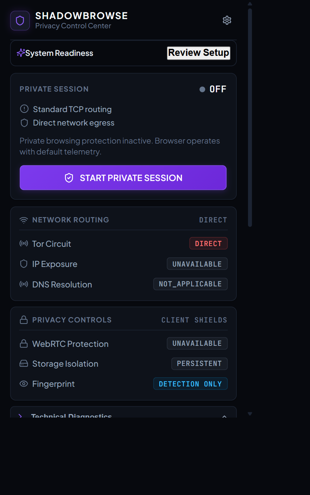
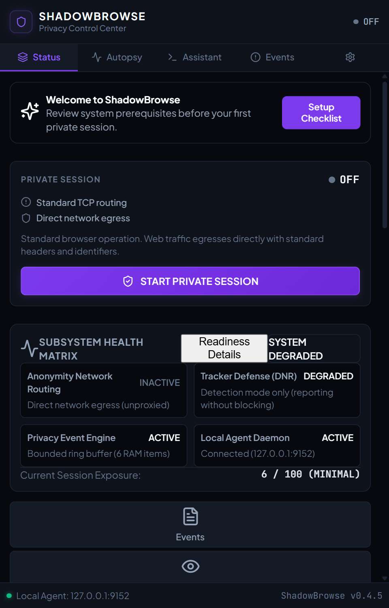
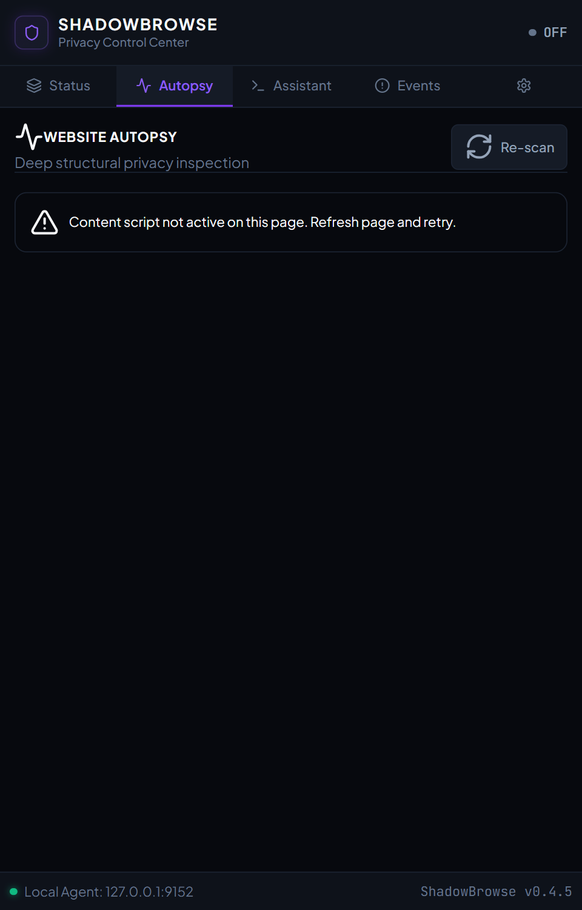
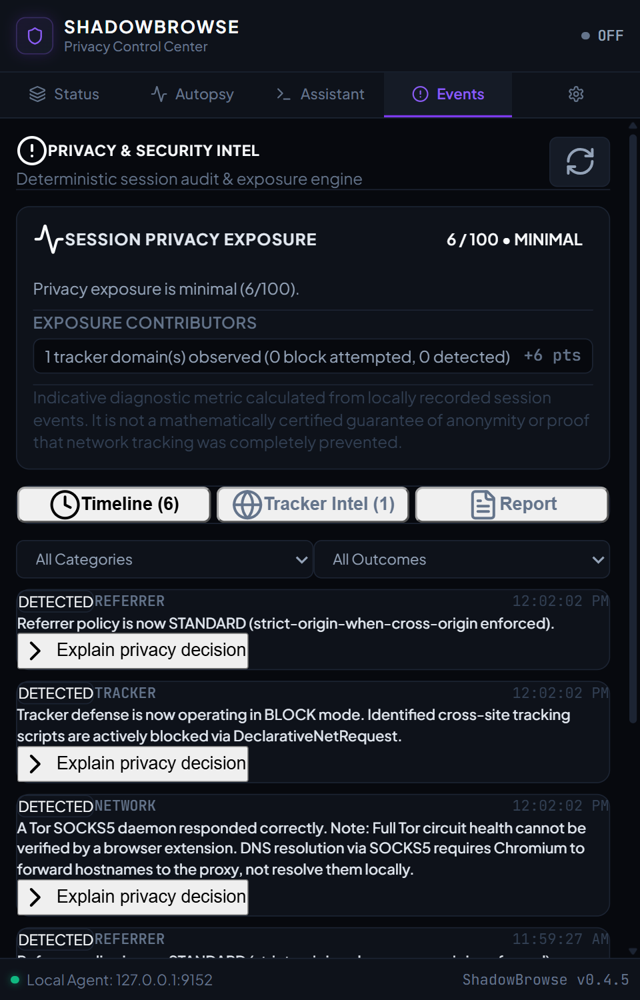

# ShadowBrowse
### Anonymous and Secure Web Browsing Extension

[](tests/)
[](extension/)
[](extension/manifest.json)
[]()

ShadowBrowse is a privacy-focused Chromium browser extension that coordinates local browser privacy defenses with verified Tor network routing. Engineered for Google Chrome, Brave, and Microsoft Edge, the project integrates client-side DOM surveillance detection, declarative tracker blocking, WebRTC leak shielding, and out-of-band Tor circuit verification into a unified defense system.

Rather than relying on superficial cosmetic filters or unverified proxy switches, ShadowBrowse utilizes a **decoupled two-tier architecture**:
1. **Manifest V3 Browser Extension (`/extension`)**: An in-browser extension featuring a compact 380px popup control center, a companion SidePanel, live **Website Autopsy 2.0**, Declarative Net Request tracker blocking, URL tracking parameter sanitization, session storage isolation, and non-spoofing fingerprint detection.
2. **Local Privacy Agent (`/agent`)**: A lightweight daemon (`shadow-agent`) binding strictly to localhost (`127.0.0.1:9152`), managing Tor provider detection, SOCKS5 remote proxy routing, control-port bootstrap auditing, independent route verification, and a fail-closed network kill switch.

---

## Table of Contents

- [Technical Philosophy & Honesty Matrix](#technical-philosophy--honesty-matrix)
- [System Architecture](#system-architecture)
- [Core Features](#core-features)
- [User Interface Views](#user-interface-views)
- [Technology Stack](#technology-stack)
- [Prerequisites](#prerequisites)
- [Installation Guide](#installation-guide)
- [Running ShadowBrowse](#running-shadowbrowse)
- [Configuration & Local API](#configuration--local-api)
- [Testing & Quality Assurance](#testing--quality-assurance)
- [Privacy Model & Technical Boundaries](#privacy-model--technical-boundaries)
- [Troubleshooting](#troubleshooting)
- [Repository Structure](#repository-structure)
- [Documentation Index](#documentation-index)

---

## Technical Philosophy & Honesty Matrix

ShadowBrowse operates on a strict rule of **technical honesty**: zero fabricated security claims, no deceptive green badges, and no synthetic noise injection that degrades usability or amplifies browser uniqueness.

| Privacy & Security Surface | Classification | Status | Technical Reality & Mechanism |
| :--- | :---: | :---: | :--- |
| **Tor Network Routing** | `PROTECTED` | Implemented | 100% of browser TCP web traffic routed through verified Tor SOCKS5 interface (`127.0.0.1:9050`). |
| **Out-of-Band Route Verification** | `PROTECTED` | Implemented | Local agent independently validates circuit egress against Tor Project directory consensus (`check.torproject.org`) via SOCKS5 before granting protected status. |
| **Fail-Closed Kill Switch** | `PROTECTED` | Implemented | Blackholes outbound browser traffic to `127.0.0.1:9` discard sink on Tor connection loss, preventing unmasked direct ISP fallback while preserving local agent communication. |
| **WebRTC Leak Shielding** | `PROTECTED` | Implemented | Enforces Chromium `disable_non_proxied_udp` policy via privacy settings API, mitigating public and local LAN IP address leaks during WebRTC peer negotiation. |
| **Tracking Parameter Sanitization** | `PROTECTED` | Implemented | Strips marketing and click tokens (`utm_*`, `gclid`, `fbclid`, `msclkid`, etc.) via client-side `history.replaceState` while preserving functional application parameters. |
| **Declarative Tracker Defense** | `PROTECTED` | Implemented | 31 curated native `chrome.declarativeNetRequest` rules blocking high-entropy tracking scripts, analytics beacons, tracking pixels, and EFF simulation domains (`trackersimulator.org`, `eviltracker.net`, `do-not-tracker.org`) across sub-frames, scripts, XHR, images, pings, and websockets. **Distinct from universal ad blocking** (does not cosmetically hide first-party inline ads). |
| **Safe Non-Blocking Policy** | `PROTECTED` | Implemented | Whitelist preservation for essential web infrastructure (CDNs, Google Fonts, Stripe/PayPal checkout frames, Cloudflare CAPTCHAs). |
| **Remote DNS Resolution** | `PARTIAL` | Documented | SOCKS5 proxy delegates hostname resolution (`ATYP 0x03`) to the Tor exit relay. Upstream DNS queries are resolved by exit node nameservers rather than the local ISP. Kernel OS UDP sockets cannot be inspected from the MV3 sandbox. |
| **Referrer Privacy Control** | `PARTIAL` | Implemented | Truncates cross-origin referrers via `modifyHeaders` declarative net request rules. |
| **Storage Isolation & Purge** | `PARTIAL` | Implemented | Full per-origin and session cookie/storage purge (`chrome.browsingData.remove`) executed at session teardown; lacks true OS-level containerization. |
| **Fingerprint Defense** | `DETECTION_ONLY` | Documented | Real-time surveillance detection for Canvas 2D, WebGL hardware vendor/renderer, and WebAudio oscillator probing. **Zero synthetic noise injection** (noise creates anomalous, high-entropy signatures; EFF Cover Your Tracks will report hardware uniqueness). |

---

## System Architecture

The following diagram illustrates the interaction between the user interface, background service worker, local privacy daemon, Tor process, and destination servers:

```mermaid
flowchart TD
    subgraph Browser ["Chromium Browser Environment (MV3)"]
        UI["Extension UI<br/>(Popup 380px / SidePanel Companion)"]
        CS["Classic Content Script (IIFE)<br/>+ In-Page Watchdog (injectGuard.js)"]
        SW["Background Service Worker<br/>(Network, Privacy & Tracker Controllers)"]
        DNR["chrome.declarativeNetRequest<br/>(31 DNR Tracker Rules)"]
        ProxyConf["Chromium Proxy API<br/>(SOCKS5 / Fail-Closed Blackhole)"]
        
        UI <-->|chrome.runtime IPC| SW
        CS <-->|postMessage / runtime| SW
        SW --> DNR
        SW --> ProxyConf
    end

    subgraph Host ["Local Host Workstation"]
        Agent["Local Privacy Agent (FastAPI)<br/>127.0.0.1:9152 (HMAC Token Auth)"]
        Tor["Tor Expert Bundle Daemon<br/>SOCKS5: 9050 | ControlPort: 9051"]
        Blackhole["Discard Sink Port<br/>127.0.0.1:9"]
        
        SW <-->|HTTP / REST (Loopback)| Agent
        Agent <-->|Control Protocol / 9051| Tor
        ProxyConf -.->|Active Protected Session| Tor
        ProxyConf -.->|Kill-Switch Triggered| Blackhole
    end

    subgraph External ["External Networks"]
        TorRelays["Tor Decentralized Relay Network<br/>(Entry Guard -> Middle -> Exit Node)"]
        TorAuth["check.torproject.org<br/>(Exit Node Directory Authority)"]
        TargetWeb["Target Web Server"]
        
        Tor <-->|Multi-Hop TLS Circuits| TorRelays
        Agent -.->|Out-of-Band SOCKS5 Query| TorAuth
        TorRelays <-->|Egress HTTP/HTTPS| TargetWeb
    end
```

---

## Core Features

### 1. Chromium Manifest V3 Architecture
- **Single-Bundle Classic Content Scripts**: Built with a specialized Vite and esbuild IIFE bundler (`format: 'iife'`) that eliminates Manifest V3 `Cannot use import statement outside a module` errors.
- **Service Worker Lifecycle Recovery**: Persistent state rehydration across worker sleep and wake cycles, maintaining proxy rules, DNS classification, and tracker states.

### 2. Toolbar Popup (380px) & SidePanel Companion
- **Real-Time Session Hero**: Visual indicators for `PROTECTED`, `PARTIAL`, `DETECTION_ONLY`, and `FAILED` states.
- **4-Point Readiness Checklist**: Pre-flight validation modal verifying Network loopback, Proxy state, Storage availability, and Tor daemon connectivity before session activation.
- **5-Tab SidePanel Companion**:
  - `STATUS`: Live telemetry drawer breaking down Tor, Route, Privacy, Session, and Agent metrics.
  - `AUTOPSY`: Structural DOM and third-party risk analysis.
  - `ASSISTANT`: In-browser privacy analysis computed locally with zero external API calls.
  - `EVENTS`: Immutable chronological audit log with severity classifications and credential redaction.
  - `SETTINGS`: Declarative defense mode toggles (`BLOCK` vs `DETECT`), WebRTC policy selection, and local daemon configuration.
- **Keyboard Accessibility**: Full WCAG-compliant keyboard navigation (`ArrowRight`, `ArrowLeft`, `Home`, `End`) across SidePanel tabs.

### 3. Website Autopsy 2.0
- **Active-Tab Tracking**: Automatically detects tab switching and page reloads via `chrome.tabs.onActivated` and `chrome.tabs.onUpdated` to prevent stale analysis.
- **Protocol & Certificate Inspection**: Validates HTTPS, TLS certificate status, and mixed-content vulnerabilities.
- **Local Loopback Classification**: Accurately classifies `127.0.0.1` and `localhost` as `LOCAL_LOOPBACK` (low risk, score: 5), informing users that local kernel IPC does not traverse network wires or expose data to remote observers.
- **Third-Party Graph & Tracker Categorization**: Analyzes first-party assets vs. third-party dependencies, categorizing tracking networks, analytics beacons, and advertising scripts.
- **DOM Fingerprint Watchdog**: Intercepts and logs access to Canvas (`toDataURL`, `getImageData`), WebGL hardware identifiers (`UNMASKED_VENDOR_WEBGL`), and WebAudio oscillators in real time.
- **Privacy Exposure Score**: Quantified 0–100 risk heuristic calculated from transport security, tracking scripts, storage keys, and DOM probing.

### 4. Declarative Tracker Defense & Sanitizer
- **31 Curated Native DNR Rules**: Evaluated by Chromium's networking core with 0ms JavaScript runtime overhead. Covers major tracking networks (DoubleClick, Criteo, Google Analytics, Facebook Pixel, Segment, Mixpanel) and EFF Cover Your Tracks test simulation domains (`trackersimulator.org`, `eviltracker.net`, `do-not-tracker.org`).
- **Complete Resource Type Coverage**: Enforces blocking across `sub_frame` iframes, `script`, `xmlhttprequest`, `image`, `ping`, `other`, and `websocket` requests.
- **Diagnostic Feedback**: Utilizes `declarativeNetRequestFeedback` and `onRuleMatchedDebug` to provide granular matching logs.
- **Link Parameter Sanitization**: Automatically strips campaign and click IDs (`utm_*`, `gclid`, `fbclid`, `msclkid`) via `history.replaceState`.

### 5. Out-of-Band Circuit Verification & Kill Switch
- **Independent Exit Consensus**: The local agent queries `https://check.torproject.org/api/ip` over SOCKS5 with remote DNS enabled (`rdns=True`), confirming that the observed public IP belongs to a verified Tor exit relay.
- **Fail-Closed Discard Blackhole**: Heartbeat polling monitors Tor health every 5000ms. If the daemon disconnects or crashes, the browser proxy is instantly redirected to `127.0.0.1:9`, completely blackholing traffic with `ERR_PROXY_CONNECTION_FAILED` and preventing direct unmasked IP leaks.
- **Exact State Restoration**: Snapshots the user's pre-session proxy settings and restores them cleanly upon session termination.

---

## User Interface Views

The following authentic screenshots represent ShadowBrowse running in Google Chrome:

| View | Screenshot | Description |
| :--- | :---: | :--- |
| **Toolbar Popup** |  | Compact 380px control center displaying single-click protected session toggle, real-time circuit health, and SidePanel navigation shortcuts. |
| **SidePanel Status & Diagnostics** |  | In-depth diagnostic matrix displaying Tor circuit confirmation, remote DNS classification, WebRTC policy, and agent health. |
| **Readiness Checklist** |  | Pre-flight 4-point verification modal confirming Network, Proxy, Storage, and Tor connectivity prior to session engagement. |
| **Website Autopsy 2.0** |  | Deep structural privacy audit of the active tab, third-party connection graphs, loopback classification, and exposure score. |
| **Security Events Audit Log** |  | Immutable chronological event timeline recording session transitions, tracker blocks, and route verifications with redaction. |

---

## Technology Stack

| Layer / Component | Technology | Version | Purpose & Implementation |
| :--- | :--- | :--- | :--- |
| **UI Framework** | React | `^18.3.1` | Modular component rendering for Popup and SidePanel interfaces |
| **Language** | TypeScript | `^5.7.3` | Strict type checking across UI, background workers, and shared types |
| **Build Tooling** | Vite / esbuild | `^6.1.0` | Production bundling, static copying, and custom classic IIFE bundling |
| **Extension Platform** | Chrome MV3 | Manifest V3 | Chromium extension standard using background service workers |
| **Icons** | Lucide React | `^0.475.0` | High-contrast UI iconography |
| **Backend Daemon** | Python | `3.10+` | Execution environment for the local privacy agent |
| **API Framework** | FastAPI | `>=0.115.0` | High-performance asynchronous REST API bound strictly to loopback |
| **ASGI Server** | Uvicorn | `>=0.32.0` | Lightweight ASGI web server for local daemon endpoints |
| **SOCKS5 Networking** | PySocks & Requests | `>=1.7.1` | SOCKS5 proxy handshake and out-of-band Tor route verification |
| **Anonymity Routing** | Tor Expert Bundle | `0.4.8.14` | Native onion routing daemon on Windows x64 (ports 9050, 9051) |
| **Testing Framework** | pytest | `>=8.0.0` | Comprehensive regression testing (213 automated tests) |

---

## Prerequisites

Before setting up ShadowBrowse, ensure your workstation meets the following requirements:

1. **Operating System**: Windows 10 or Windows 11 (x64 architecture).
2. **Chromium-Based Browser**: Google Chrome (v116+), Brave, or Microsoft Edge.
3. **Node.js**: Node.js 18.x or 20.x LTS with `npm`.
4. **Python**: Python 3.10+ (ensure `python` and `pip` are accessible via system `PATH`).
5. **Bundled Tor Executable**: Verified present at `agent/bin/tor/tor/tor.exe` with configuration at `agent/bin/tor/torrc`.

---

## Installation Guide

Follow these step-by-step instructions to set up the project on Windows:

### Step 1: Clone the Repository
```powershell
git clone https://github.com/VAWRix/ShadowBrowse.git
cd ShadowBrowse
```

### Step 2: Install Extension Dependencies & Build Bundle
```powershell
# Navigate to extension directory
cd extension

# Install npm dependencies
npm install

# Verify TypeScript compilation (0 errors expected)
npm run typecheck

# Build production bundle (outputs to extension/dist)
npm run build

# Return to repository root
cd ..
```

### Step 3: Install Python Agent Dependencies
```powershell
# Install required Python packages
pip install -r agent/requirements.txt
```

### Step 4: Load Extension into Google Chrome
1. Open Google Chrome and navigate to `chrome://extensions/`.
2. Enable **Developer mode** using the toggle in the top-right corner.
3. Click **Load unpacked** in the top-left corner.
4. Browse to and select the `extension/dist` directory inside the repository.
5. Confirm that **ShadowBrowse** appears with its version, icon, and ID.

---

## Running ShadowBrowse

### Recommended Launcher Workflow

ShadowBrowse includes dedicated launchers that handle daemon lifecycle management and port conflict checks.

#### 1. Starting Services
From the repository root, double-click or run:
```cmd
START_ALL.bat
```
This script:
1. Validates Tor binary, configuration, and Python entry points.
2. Checks for port conflicts on `9050`, `9051`, and `9152`.
3. Launches the native Tor daemon and verifies 100% bootstrap via the ControlPort protocol.
4. Launches the Python FastAPI agent and confirms HTTP health on `http://127.0.0.1:9152`.

> **Note**: `START_ALL.bat` starts background support daemons only. It does **not** alter your browser's proxy settings. Your browser remains on direct internet connection until you explicitly initiate a protected session.

#### 2. Activating a Protected Session
1. Open Google Chrome and click the **ShadowBrowse** icon in the toolbar.
2. Click **Readiness Checklist** to verify Network, Proxy, Storage, and Tor readiness.
3. Click **START PRIVATE SESSION**.
4. The extension snapshots your existing proxy configuration, applies Tor SOCKS5 routing (`127.0.0.1:9050`), locks WebRTC UDP traffic, and triggers out-of-band circuit verification.
5. The badge illuminates emerald green with **`PROTECTED`** status.

#### 3. Stopping Services Safely
When you are finished browsing:
1. Click **END PRIVATE SESSION** in the extension popup to restore your original proxy configuration and purge session data.
2. Run the safe teardown script from the repository root:
```cmd
STOP_ALL.bat
```
This cleanly terminates the Tor daemon and Privacy Agent processes, freeing ports 9050, 9051, and 9152 without affecting unrelated system processes.

---

## Configuration & Local API

The local Privacy Agent operates as an isolated loopback service. All endpoints bind strictly to `127.0.0.1` and require constant-time HMAC token authentication (`secrets.compare_digest`) for privileged operations.

| Service / Interface | Local Address | Protocol | Description |
| :--- | :--- | :--- | :--- |
| **Privacy Agent** | `127.0.0.1:9152` | HTTP / REST | Local daemon providing status, diagnostics, and out-of-band verification |
| **Tor SOCKS5 Proxy** | `127.0.0.1:9050` | SOCKS5 (RFC 1928) | Local interface for multi-hop onion routing |
| **Tor ControlPort** | `127.0.0.1:9051` | Tor Control Spec | Control protocol interface for bootstrap polling and circuit status |
| **Discard Blackhole** | `127.0.0.1:9` | TCP Discard | Local blackhole destination for the fail-closed kill switch |

### Primary Local API Endpoints

- `GET http://127.0.0.1:9152/status`: Returns agent health, Tor connectivity, and proxy status.
- `GET http://127.0.0.1:9152/tor/provider`: Returns Tor provider information, circuit status, and bootstrap percentage.
- `GET http://127.0.0.1:9152/diagnostics`: Returns system diagnostic telemetry, port bindings, and runtime checks.
- `POST http://127.0.0.1:9152/verify`: Initiates an out-of-band SOCKS5 exit verification query to `check.torproject.org`.

---

## Testing & Quality Assurance

ShadowBrowse maintains an extensive test suite covering network routing, security boundaries, DNR filtering, service worker state restoration, and clean-install package validation.

### Automated Regression Commands

```powershell
# 1. TypeScript Strict Typecheck (0 errors)
npm --prefix extension run typecheck

# 2. Production Extension Build (Transforms 1622 modules cleanly)
npm --prefix extension run build

# 3. Python Pytest Regression Suite (213 tests across 15 suites)
python -m pytest tests/ -q
```

### Verified Test Suite Breakdown

| Test Suite Module | Tests | Focus Area |
| :--- | :---: | :--- |
| `tests/security/test_phase10_final_audit.py` | 13 | Classic content-script IIFE bundling, DNR tracker rules, EFF test domains, loopback autopsy classification |
| `tests/network/test_dns_classification_and_diagnostics.py` | 4 | 7-state DNS transparency contracts, SOCKS5 remote resolution, diagnostic explainability |
| `tests/security/test_phase7_security_hardening.py` | 18 | Host-header injection rejection, loopback enforcement, 64KB message limits, HMAC token auth |
| `tests/reliability/test_phase8_reliability_acceptance.py` | 22 | Ring buffer caps (<=200 events), sub-millisecond event ingestion (<0.8ms), storage recovery |
| `tests/network/test_phase3_network.py` | 15 | Proxy state snapshot/restore, fail-closed blackhole discard routing, SOCKS5 handshake |
| `tests/privacy/test_phase4b_mitigation.py` | 16 | Declarative Net Request filtering, tracking parameter sanitization (`utm_*`, `gclid`), referrer policy |
| `tests/privacy/test_phase5a_event_engine.py` | 14 | Event ingestion, structured serialization, origin sanitization, race-free storage clearing |
| `tests/privacy/test_phase5b_risk_engine.py` | 12 | Deterministic exposure scoring, risk factor categorization, bounded weight caps |
| `tests/reliability/test_phase12_production_packaging.py` | 4 | Clean package extraction, file manifest verification, zero source maps, zero credentials |
| **Total Test Count** | **213** | **100% full-suite passing in under 39 seconds** |

### Controlled Browser Automation Tests
- `node scripts/test_eff_tracker_simulation.mjs`: Uses Chrome DevTools Protocol (CDP) to assert that sub-frame and network requests to `trackersimulator.org` and `eviltracker.net` are blocked with `net::ERR_BLOCKED_BY_CLIENT`.
- `node scripts/test_autopsy_tab_sync.mjs`: Asserts that Website Autopsy synchronizes when switching active browser tabs and assigns `LOCAL_LOOPBACK` certificate status to loopback addresses.

---

## Privacy Model & Technical Boundaries

In adherence to rigorous security engineering, ShadowBrowse explicitly documents its technical boundaries and non-claims:

1. **Tor Routing vs. Complete Anonymity**: Tor routes TCP traffic through three encrypted relays, hiding the user's IP address from destination websites and hiding destination websites from the local ISP. However, Tor cannot protect against application-level identification. If a user logs into personal accounts (e.g., Google, Amazon) or submits identifying information, the website identifies the user regardless of network proxying.
2. **SOCKS5 Remote DNS Resolution**: Chromium's proxy API delegates domain resolution to the Tor exit relay via SOCKS5 (`ATYP 0x03`). Upstream DNS queries are resolved by exit node nameservers rather than the user's ISP. Because Manifest V3 extensions cannot inspect raw OS kernel UDP sockets on port 53, DNS classification is honestly designated as **`PARTIAL (SOCKS5 Tor Remote)`**.
3. **Tracker Defense vs. Universal Ad Blocking**: ShadowBrowse's 31 Declarative Net Request rules block cross-site tracking scripts, analytics beacons, tracking pixels, and surveillance frames. It does **not** inject cosmetic CSS element-hiding rules to remove inline first-party advertisements that do not emit tracking beacons.
4. **Fingerprint Auditing is Detection-Only**: Website Autopsy intercepts and audits Canvas, WebGL, and WebAudio probing. ShadowBrowse **does not** inject synthetic canvas noise or spoof hardware strings. Academic literature confirms that artificial noise creates distinct, high-entropy mathematical signatures that make a browser *more* unique. As a result, tools like EFF Cover Your Tracks will report hardware uniqueness.
5. **Local Loopback vs. Remote HTTP**: Navigating to `http://127.0.0.1` or `http://localhost` communicates over local kernel inter-process communication (IPC). It is classified as `LOCAL_LOOPBACK` with a low exposure score (5) because local loopback packets never traverse physical network interfaces or the public Internet.
6. **Autopsy Exposure Score**: The 0–100 privacy exposure score is an internal heuristic calculated from observed transport security, third-party requests, tracking parameters, and DOM probing. It represents an engineering assessment, not a formal third-party certification.

---

## Troubleshooting

### 1. Extension Content Script Shows SyntaxError on Page Load
- **Symptom**: `Uncaught SyntaxError: Cannot use import statement outside a module` in Chrome extension error logs.
- **Cause**: Chrome MV3 executes content scripts as classic scripts. Standard Vite bundling generated unbundled ES module imports.
- **Resolution**: Run `npm --prefix extension run build`. Our custom Vite plugin bundles `content.js` and `injectGuard.js` as self-contained classic IIFE scripts with inlined dependencies.

### 2. Local Privacy Agent Reports "DISCONNECTED" or "UNAVAILABLE"
- **Symptom**: Status badge shows `AGENT: DISCONNECTED` or `AGENT: UNAVAILABLE`.
- **Cause**: The local Python daemon is not running on `127.0.0.1:9152`, or port 9152 is occupied.
- **Resolution**:
  - Run `.\START_ALL.bat` to launch the daemon.
  - Test health manually in PowerShell: `Invoke-RestMethod http://127.0.0.1:9152/status`.
  - Check for port conflicts: `netstat -ano | findstr :9152`.

### 3. Tor Bootstrap Stalls or Fails to Reach 100%
- **Symptom**: Console indicates Tor bootstrap paused at 5% or 10%.
- **Cause**: Local firewall or antivirus is blocking outbound connections on port 9050/9051, or an orphaned `tor.exe` process is bound to the ports.
- **Resolution**:
  - Run `.\STOP_ALL.bat` to kill orphaned processes.
  - Verify that `agent\bin\tor\tor\tor.exe` has outbound network access in Windows Defender Firewall.

### 4. Website Autopsy Shows Stale or Inaccurate Page Data
- **Symptom**: Autopsy displays metrics from a previously closed tab.
- **Cause**: Content script message listener was not triggered or tab switch was not detected.
- **Resolution**: Switch to the target tab and click **Re-scan Tab** inside the Autopsy view. Ensure the active tab is not an internal browser page (`chrome://` or `about:blank`), which blocks content script injection.

### 5. Protected Session Cannot Start (Readiness Checklist Fails)
- **Symptom**: "Start Private Session" button remains disabled or readiness modal fails.
- **Cause**: One of the 4 prerequisites (Network loopback, Proxy permission, Storage, Tor daemon) failed verification.
- **Resolution**: Open the Readiness Checklist modal to see which specific check failed, ensure background daemons are active via `START_ALL.bat`, and verify that the extension has proxy permissions in `chrome://extensions/`.

---

## Repository Structure

```
ShadowBrowse/
├── agent/                         # Local Python Privacy Daemon
│   ├── bin/tor/                   # Bundled Tor 0.4.8.14 expert bundle & torrc
│   ├── src/                       # FastAPI routes, route verifier & authentication
│   └── requirements.txt           # Python daemon dependencies (FastAPI, Uvicorn, PySocks)
├── docs/                          # Architecture specs, threat models & audit reports
├── extension/                     # Manifest V3 Browser Extension
│   ├── public/manifest.json       # MV3 declaration, permissions & content script mappings
│   ├── src/
│   │   ├── background/            # Service worker, Network, Privacy & Tracker controllers
│   │   ├── content/               # Content script (IIFE) & in-page DOM guard
│   │   ├── popup/                 # Compact 380px Toolbar Popup interface
│   │   ├── sidepanel/             # Companion views (Status, Autopsy, Assistant, Events, Settings)
│   │   └── shared/                # TypeScript interfaces, constants & event contracts
│   ├── package.json               # Extension dependencies (React 18, TypeScript, Vite)
│   └── vite.config.ts             # Custom Rollup build config with classic IIFE bundler
├── scripts/                       # Maintenance, verification & document generator scripts
│   ├── service_manager.py         # Subsystem lifecycle manager & conflict detector
│   ├── test_eff_tracker_simulation.mjs  # CDP test for DNR tracker blocking
│   └── test_autopsy_tab_sync.mjs  # CDP test for Autopsy active-tab synchronization
├── submission/                    # Academic reports, presentation slides & screenshots
│   ├── screenshots/               # Authentic high-resolution Chrome DevTools screenshots
│   ├── FINAL_AUDIT_AND_DEMO_READINESS.md  # Complete 13-gate audit readiness report
│   └── README_SUBMISSION.txt      # Deliverable inventory with SHA-256 checksums
├── tests/                         # Automated test suite (213 passing tests)
│   ├── network/                   # SOCKS5 routing, DNS classification & live Tor validation
│   ├── privacy/                   # Event engine, risk engine & DNR tracker tests
│   ├── reliability/               # Ring buffer caps, storage recovery & package hygiene
│   └── security/                  # Host-header rejection, HMAC token auth & IIFE bundling
├── START_ALL.bat                  # One-click startup launcher for Tor and Privacy Agent
├── STOP_ALL.bat                   # Clean teardown launcher for background daemons
└── README.md                      # Primary project documentation
```

---

## Documentation Index

| Document | Path | Description |
| :--- | :--- | :--- |
| **Architecture Specification** | [docs/architecture.md](docs/architecture.md) | Architectural breakdown of extension controllers and local agent daemon |
| **Threat Model** | [docs/threat-model.md](docs/threat-model.md) | High-level system threat model and adversary assumptions |
| **Privacy Model** | [docs/privacy-model.md](docs/privacy-model.md) | Privacy principles, data minimization boundaries, and local containment |
| **Security Model** | [docs/security-model.md](docs/security-model.md) | Extension sandbox constraints, daemon authentication, and CSP rules |
| **Technical Limitations** | [docs/limitations.md](docs/limitations.md) | Comprehensive specification of non-claims and technical boundaries |
| **Tor Integration Guide** | [docs/tor-integration.md](docs/tor-integration.md) | SOCKS5 proxy configuration, ControlPort monitoring, and circuit handling |
| **Privacy Claims Matrix** | [docs/privacy-claims.md](docs/privacy-claims.md) | Canonical definitions of claims vs. non-claims |
| **Development Guide** | [docs/development.md](docs/development.md) | Developer setup, code conventions, and manual debugging workflows |
| **Final Audit & Demo Report** | [submission/FINAL_AUDIT_AND_DEMO_READINESS.md](submission/FINAL_AUDIT_AND_DEMO_READINESS.md) | 13-gate audit report, test evidence, and live demonstration runbook |
