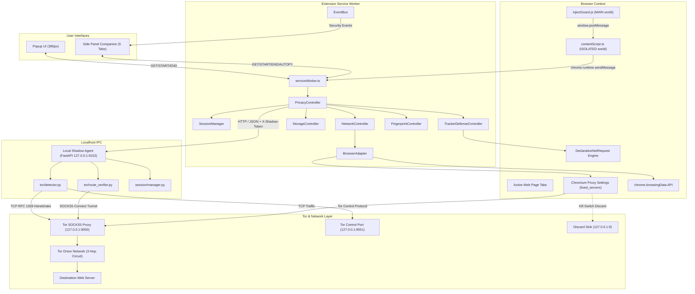
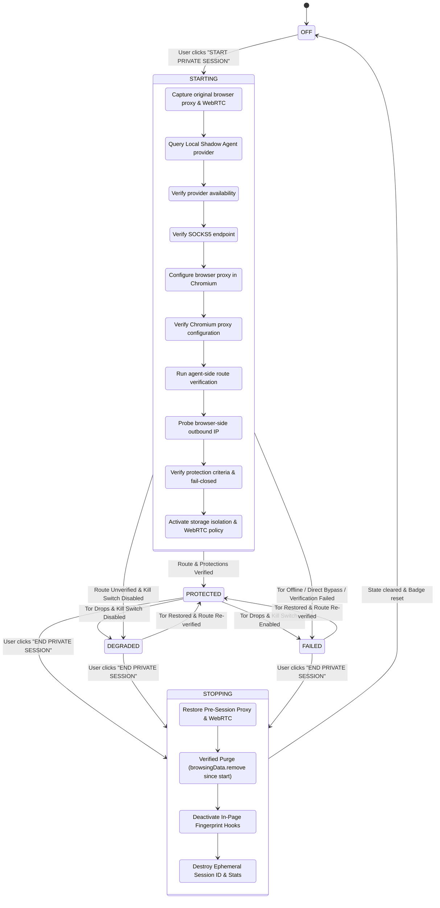
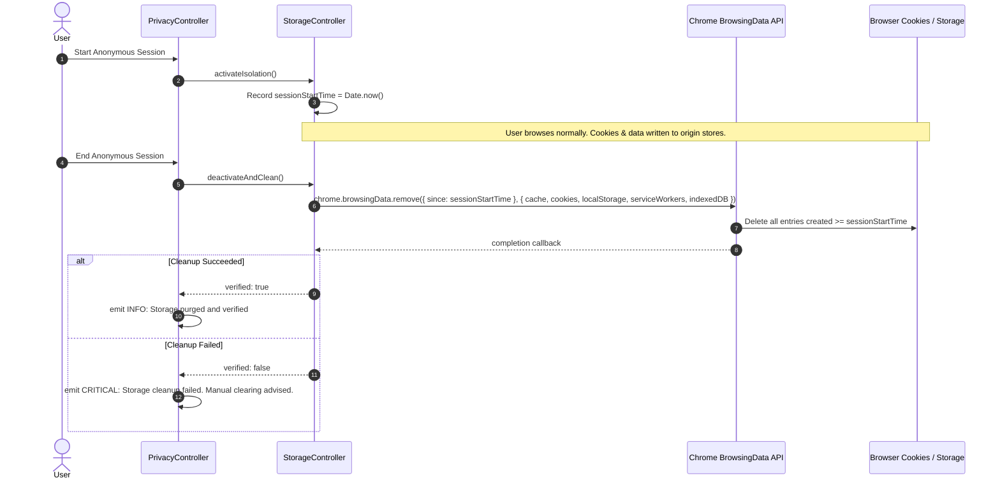

# ShadowBrowse — Architecture & Data Flow Specification

**Date:** October 25, 2026  
**Status:** Complete & Audited  
**Architecture Version:** 0.4.5 (Chromium Manifest V3 + Local Python Daemon)  

---

## 1. System Overview & Component Topology

ShadowBrowse divides browser privacy responsibilities into two distinct, loosely coupled tiers:

1. **Manifest V3 Extension Layer (Chromium Client)**
   - Responsible for in-browser telemetry, UI display, declarative request interception, URL parameter sanitization, storage boundary isolation, and Chrome proxy configuration.
2. **Local Shadow Agent Layer (`shadow-agent` Daemon)**
   - Responsible for native OS socket interaction, RFC 1928 SOCKS5 protocol handshakes, Tor Control Port daemon authentication, external route verification, and fail-closed network kill switch enforcement.



---

## 2. Session State Machine & Flow

ShadowBrowse operates a deterministic 6-state lifecycle:



---

## 3. Detailed Data Flows

### 3.1 Network Routing Flow

```
[Browser Outbound Request]
       │
       ▼
[Chromium Network Stack]
       │
       ├─► Check Proxy Rules (mode: fixed_servers)
       │     └─► SingleProxy: socks5://127.0.0.1:9050
       │     └─► BypassList: <-loopback>, 127.0.0.1, localhost
       │
       ├─► Remote Hostname Resolution:
       │     Browser sends SOCKS5 CONNECT with ATYP 0x03 (domain name)
       │     Local DNS resolution bypassed; Tor exit node resolves DNS remotely.
       │
       ▼
[Tor Onion Network]
       │
       ▼
[Exit Node] ──► [Target Web Server]
```

### 3.2 Kill-Switch Fail-Closed Flow

When the background service worker or local agent detects that Tor has disconnected during a protected session:
1. `privacyController.ts` transitions state to `FAILED`.
2. `networkController.ts` immediately configures `chrome.proxy.settings` with a SOCKS5 blackhole pointing to `127.0.0.1:9` (IANA discard port).
3. The bypass list preserves `127.0.0.1` and `localhost` so the extension can continue monitoring the local agent daemon on port 9152.
4. All web traffic outbound from Chromium fails instantly with hard socket connection errors. Direct internet fallback is strictly prevented.
5. `EventBus` emits a `CRITICAL` kill-switch activation event.

### 3.3 Storage Cleanup Flow

Unlike operating system containers, Chromium extension APIs do not permit per-tab storage virtualization. ShadowBrowse solves this via strict lifecycle boundaries:



### 3.4 Tracking Mitigation Flow

```
1. Navigation URL: https://shop.example/product?id=123&utm_source=ad&gclid=xyz
2. Content Script executes at document_start
3. contentScript.ts queries trackingParamMode setting
4. Mode == SANITIZE:
   - Separates functional keys (id=123) from tracking keys (utm_source, gclid)
   - Executes window.history.replaceState('', '', '/product?id=123')
   - URL updated in address bar without page reload
   - Emits TRACKING_PARAM INFO event
5. Outbound Subresource Requests:
   - Evaluated by DeclarativeNetRequest dynamic rules (IDs 101-402)
   - Matches google-analytics.com or doubleclick.net? Blocked natively before network dispatch.
   - Matches cdnjs.cloudflare.com or api.stripe.com? Allowed by safe whitelist policy.
```

### 3.5 Security Events & UI Communication Flow

```
In-Page Probe (injectGuard)
   │ window.postMessage
   ▼
Content Script (contentScript.ts)
   │ chrome.runtime.sendMessage({ type: 'PAGE_SECURITY_EVENT' })
   ▼
Service Worker (serviceWorker.ts)
   │ EventBus.getInstance().emit()
   ▼
EventBus (In-Memory Buffer, max 100 items)
   │ Subscriptions / Polling via GET_SECURITY_EVENTS
   ▼
SidePanel SecurityEventsView.tsx / Autopsy.tsx / Chat.tsx
```

---

## 4. Trust Boundaries & Security Model

| Boundary | Threat Vector | Mitigation Mechanism |
| :--- | :--- | :--- |
| **Untrusted Web Page ──► In-Page Guard** | Malicious script tampering with hooks or prototype poisoning | Guard runs inside IIFE, sets non-configurable flag, handles errors quietly. |
| **In-Page Guard ──► Content Script** | Malicious script sending fake `window.postMessage` events | Content script verifies `event.source === window` and checks secret payload tag `SHADOWBROWSE_PAGE_SIGNAL`. |
| **Content Script ──► Background Service Worker** | Injected script flooding messages or forging sensitive actions | Service worker only accepts defined message types (`PAGE_SECURITY_EVENT`, `ANALYZE_CURRENT_TAB`); sensitive session start/stop and settings changes require extension popup/sidepanel contexts. |
| **Web Origin ──► Local Shadow Agent** | Drive-by CSRF / DNS rebinding attacks from public websites | Agent checks `request.client.host in {'127.0.0.1', '::1', 'localhost'}` and enforces strict Origin/Referer regex permitting only `chrome-extension://[a-z]{32}` or localhost tools. All external web origins rejected with 403. |
| **Local Script ──► Local Shadow Agent** | Unauthorized local process invoking agent control APIs | All sensitive endpoints (`/session/*`, `/tor/verify-route`, `/diagnostics`) require 256-bit random cryptographic bearer token in `X-Shadow-Token` header, validated with `hmac.compare_digest`. Query parameter fallback prohibited. |
| **Chromium ──► Tor Route** | Accidental direct bypass when Tor circuit fails | Fail-closed kill switch binds Chromium proxy to `127.0.0.1:9` discard sink; verified by route comparison checks. |
